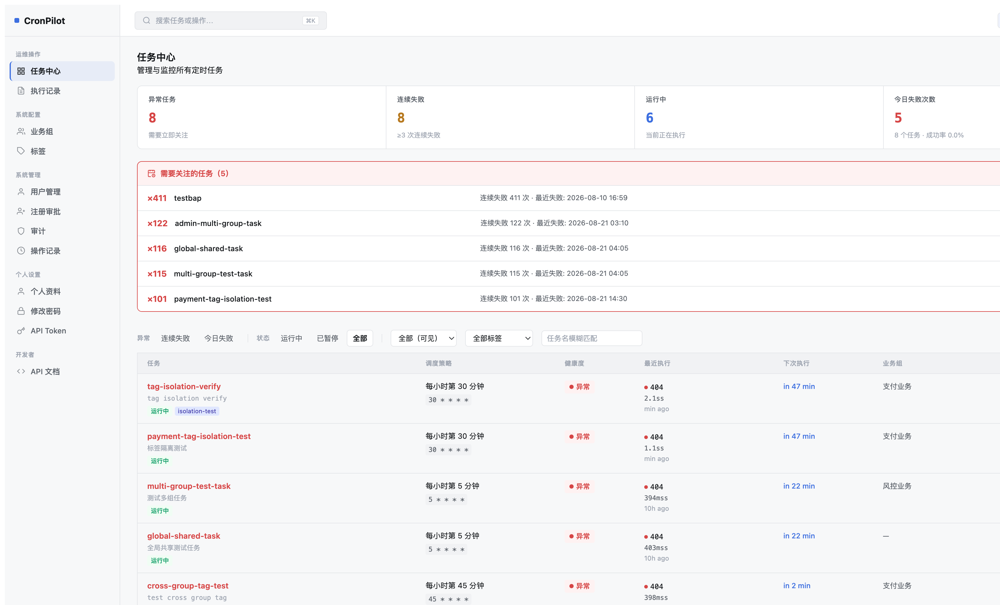
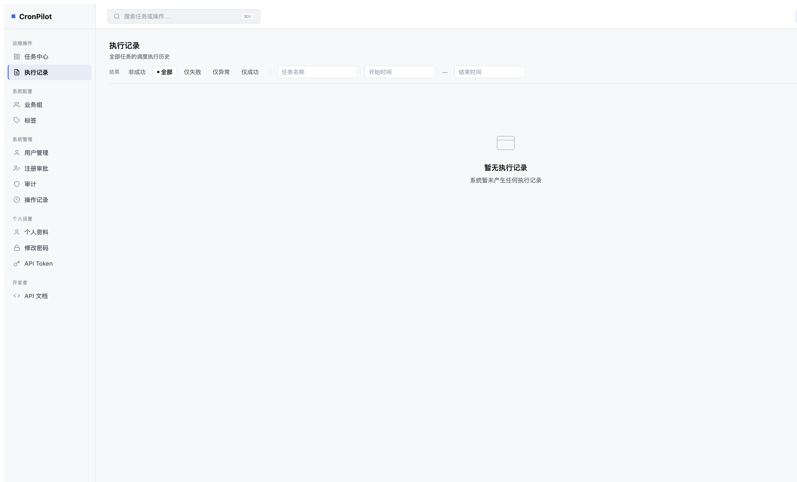
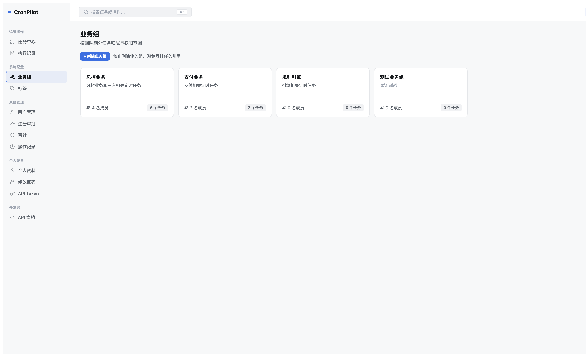
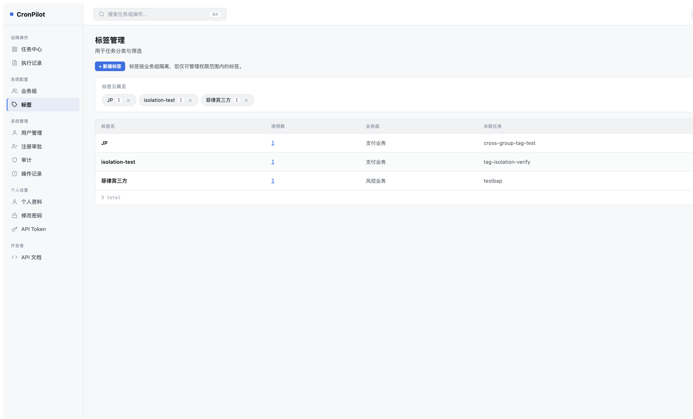
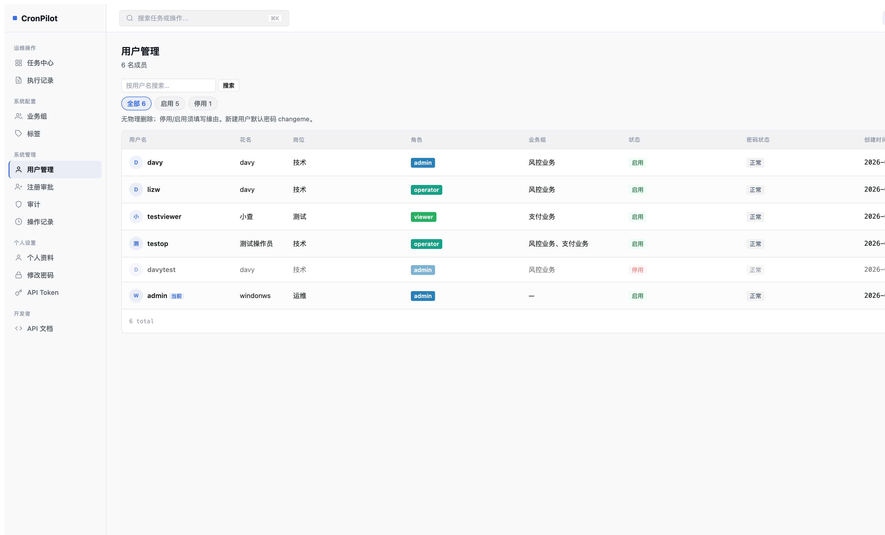
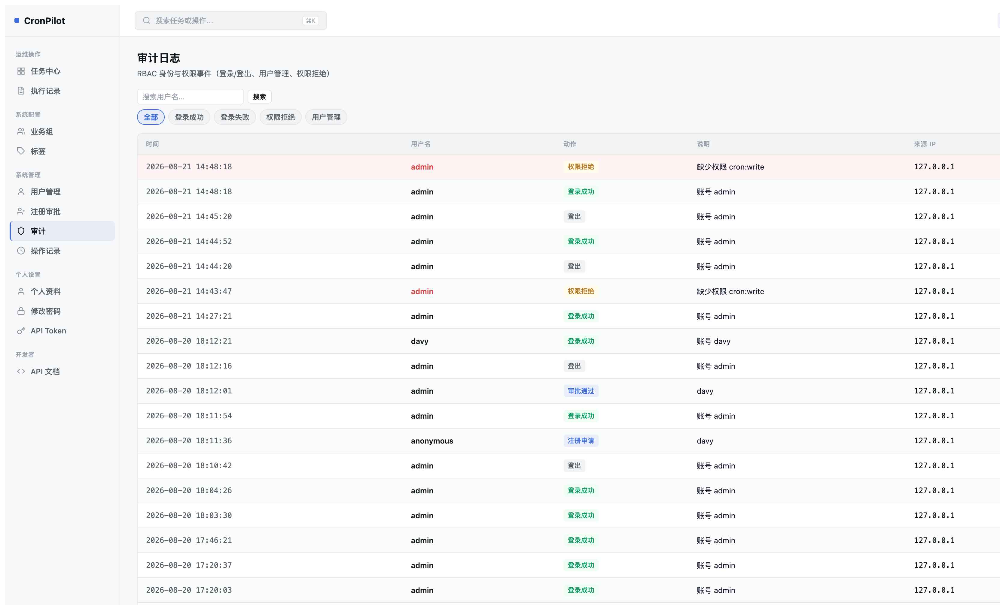
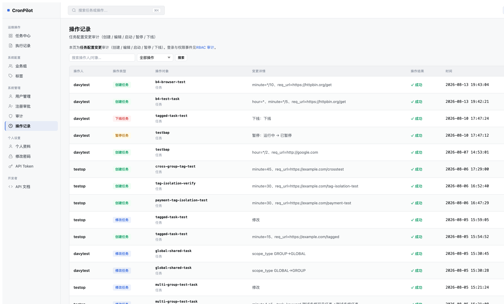
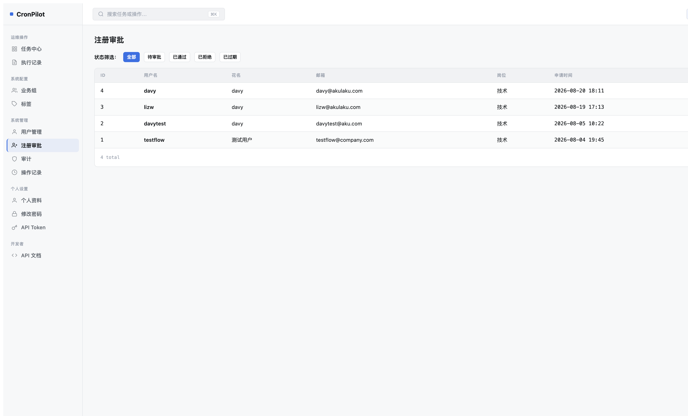

# CronPilot 第9轮 Mockup 对比评估（2026-08-18）

> HTML 版：[UI重设计-第九轮Mockup对比评估.html](UI重设计-第九轮Mockup对比评估.html) · [文档索引](../../index.html) · [索引 Markdown](../../index.md)

# CronPilot 第9轮 Mockup 对比评估

对照权威内部 Mockup：`doc/design/CronPilot-2026-redesign-mockup.html`（23 个视图）· 评估时间：2026-08-18

15

评估页面数

18

🔴 高优先级偏差

28

🟡 中优先级偏差

2

✅ 完全符合页面

### 页面评估目录

- [任务中心（PARTIAL）](#dashboard)
- [执行记录（FAIL 🔴）](#exec-logs)
- [任务详情（PASS ✅）](#task-detail)
- [执行详情（PARTIAL）](#run-inspector)
- [用户管理（PARTIAL）](#users)
- [业务组（FAIL 🔴）](#groups)
- [审计日志（PASS ✅）](#audit)
- [标签管理（FAIL 🔴）](#tags)
- [任务表单（FAIL 🔴）](#task-form)
- [操作记录（PARTIAL）](#op-log)
- [修改密码（PARTIAL）](#change-pwd)
- [API Token（PARTIAL）](#api-token)
- [注册审批（FAIL 🔴）](#reg-review)
- [用户表单（PARTIAL）](#user-form)
- [业务组表单（PARTIAL）](#group-form)

🔴 HIGH — 功能结构性偏差（列数错误、核心组件缺失）

🟡 MEDIUM — 交互/视觉偏差（按钮类型、筛选器结构、副标题）

⚪ LOW — 文案/样式细节

## 任务中心 (dashboard.html)

PARTIAL

#### Mockup 规格 (view-dashboard)

- 7列表格：任务/调度策略/健康度/最近执行/下次执行/业务组/操作
- Stats: 4 卡片（异常任务/连续失败/运行中/今日失败次数）
- Exception Panel（需要关注的任务）
- Chip 筛选器 + 数量徽章（全部128/异常3/运行中6/暂停12/已下线4）
- 行内 icon-only 操作：立即执行/暂停/更多
- 页头右上角"新建任务"按钮

#### 当前实现

- ✅ 7列表格正确（任务/调度策略/健康度/最近执行/下次执行/业务组/操作）
- ✅ 4个Stats卡片匹配Mockup标签
- ✅ Exception Panel（需要关注的任务 5 条）
- ❌ 筛选器改为按钮组+下拉框，无数量徽章，无"已下线"chip
- ❌ 操作列：立即执行icon + 执行记录icon + 更多下拉（与mockup不同）
- ❌ 新建任务在筛选栏，非页头右上角

D2 🟡

新建任务 CTA 位置

Mockup: 页头右上角 btn-primary
实际: stat-line 内行内链接

D3 🟡

筛选栏结构不符

Mockup: chip 筛选器（含数量徽章，5种状态）
实际: 按钮组 + 下拉框，无计数徽章，无"已下线"

D5 🟡

行操作按钮

Mockup: 3 个 inline icon（立即执行/暂停/更多）
实际: 执行icon + 执行记录icon + 更多下拉

## 执行记录 (execution\_logs.html)

FAIL 🔴

#### Mockup 规格 (view-logs)

- 7列：**任务 / 触发时间 / 耗时 / 响应码 / 状态 / 失败原因 / (icon操作)**
- Chip 筛选器：全部/失败/超时 + 业务组▾
- 状态列：health badge（绿/红）
- 操作：icon-only eye 图标（查看详情）
- 失败行背景高亮（danger-bg）

#### 当前实现

- 7列（数量相同但内容完全不同）：**LOG ID / 任务名称 / 返回内容 / 执行时间 / 耗时 / 结果 / 操作**
- ❌ 缺少：响应码、失败原因 独立列
- ❌ 筛选器：结果状态按钮组 + 日期范围（非chip）
- ❌ 操作：文字按钮"详情"（非icon-only）
- ⚠️ 失败行左边框高亮（与Mockup 背景高亮不同）

D1 🔴

表格列名完全不符（7列但内容差异显著）

Mockup: 任务|触发时间|耗时|响应码|状态|失败原因|icon
实际: LOG ID|任务名称|返回内容|执行时间|耗时|结果|详情

D2 🔴

缺少 响应码 和 失败原因 独立列

Mockup: 独立的 响应码(HTTP status) 和 失败原因 列
实际: 合并到 返回内容/结果 中，无法按字段筛选

D3 🟡

筛选器结构不符

Mockup: chip(全部/失败/超时) + 业务组▾
实际: 状态按钮组(5种) + 任务名/内容搜索 + 日期范围

D4 🟡

操作列按钮类型

Mockup: icon-only 眼睛图标
实际: 文字按钮"详情"

## 业务组 (groups.html)

FAIL 🔴

#### Mockup 规格 (view-groups)

- 3-卡片概览（成员/任务/**异常** 三个统计）
- 展开的组详情面板（Scope Console）
- 成员列表（头像+角色）
- 权限 Scope checklist
- 组内任务列表（含健康状态）

#### 当前实现

- ✅ 卡片概览（成员/任务，**缺"异常"统计**）
- ❌ 无 Scope Console 展开面板
- ❌ 无成员列表（头像+角色）
- ❌ 无权限 Scope checklist
- ❌ 无组内任务列表

D1 🔴

完全缺失 Scope Console 展开详情面板

Mockup: 成员列表 + 权限Scope + 组内任务 全面板
实际: 点击卡片跳转编辑表单，无详情面板

D2 🔴

卡片缺少"异常"统计指标

Mockup: 3统计（成员/任务/异常）
实际: 2统计（成员/任务）

D4 🟡

缺少成员头像堆叠和组内任务行

Mockup: 成员头像+角色列表；任务行含健康标记
实际: 不存在

## 标签管理 (tags.html)

FAIL 🔴

#### Mockup 规格 (view-tags)

- 按**命名空间**分组展示：业务域/优先级/生命周期/区域
- 每个命名空间内：pill 标签 + 数量徽章
- **无表格**（纯 pill 卡片布局）
- 命名空间标题（含SVG图标）

#### 当前实现

- ✅ Tag cloud（标签云概览，pill + 数量）
- ❌ 无命名空间分类（所有标签扁平展示）
- ❌ 增加了 5列管理表格（标签名/使用数/业务组/关联任务/操作）
- ❌ 增加了重命名/删除操作（Mockup 无此入口）

D1 🔴

信息架构完全不同（命名空间 vs 扁平表格）

Mockup: 按命名空间分组的4区块 pill 布局
实际: tag 云 + 5列管理表格

D2 🔴

Mockup 无表格，实际是表格为主

Mockup: 零表格，只有 namespace pill
实际: c-table（5列）是主体 UI

## 用户管理 (users.html)

PARTIAL

#### Mockup 规格 (view-users)

- 9列：用户(avatar+邮箱)/花名/岗位/角色/业务组/状态/密码状态/创建时间/操作
- Chip 筛选器（全部/启用/停用 含数量）
- 角色▾ 和 业务组▾ 下拉筛选
- 操作：文字 btn 重置密码/停用 + icon 编辑

#### 当前实现（A2 后）

- ✅ 9列结构（用户名/花名/岗位/角色/业务组/状态/密码状态/创建时间/操作）
- ✅ Chip 筛选器（全部/启用/停用 含数量）
- ❌ 无角色▾/业务组▾ 下拉筛选
- ❌ 用户列无邮箱副标题（Mockup有）
- ❌ 操作改为4个icon-only按钮（Mockup是文字+icon混合）

D1 🟡

用户列缺少邮箱副标题

Mockup: 用户名 + 邮箱（mono副行）
实际: 头像 + 用户名（无邮箱）

D2 🟡

缺少角色▾/业务组▾筛选器

Mockup: 筛选栏包含 角色▾ 和 业务组▾ 下拉
实际: 只有状态chip + 用户名搜索

D3 🟡

操作列按钮样式不符

Mockup: btn-sm 文字"重置密码"/"停用" + icon编辑
实际: 4个icon-only按钮（含tooltip）

## 任务详情 (task\_detail.html)

PASS ✅

✅ 结构完全符合 Mockup。4个detail卡片（健康度/调度/最近执行/配置信息）+ 健康指标 + 最近执行列表 + 配置网格均正确实现。细节差异（额外的Esc提示、复制ID按钮）为增强功能，不视为偏差。

## 执行详情 (run\_inspector.html)

PARTIAL

D1 🟡

请求区块缺少 Headers 展示

Mockup: Headers（Content-Type, X-CronPilot-Sign）
实际: 只有method + URL + 可选Body

D2 🟡

元数据字段不一致

Mockup: 任务/业务组/触发方式/**执行节点/时区**
实际: 任务/业务组/触发方式/**Log ID/超时阈值**

## 审计日志 (audit\_logs.html)

PASS ✅

✅ 6列结构（时间/用户名/动作/说明/来源IP/结果）和Chip筛选器（全部/登录成功/登录失败/权限拒绝/用户管理）均与Mockup完全匹配。权限拒绝行高亮正确。

## 任务创建/编辑 (task\_form.html)

FAIL 🔴

#### Mockup 规格

- 4 个分区卡片（基础信息/请求配置/调度配置/Lifecycle）
- 调度：预设chip按钮 + 单行cron表达式 + 人性化预览 + 时区选择
- Lifecycle 开关（启用任务）
- 面包屑导航
- 任务说明：textarea

#### 当前实现

- ❌ 扁平字段列表（无分区卡片）
- ❌ 调度：5个独立cron字段 + Vue验证组件（无预设chip/人性化预览/时区）
- ❌ 无 Lifecycle 开关
- ❌ 无面包屑
- ❌ 任务说明：单行input（非textarea）

D1 🔴

缺少分区卡片布局

Mockup: 4个带标题的bordered分区卡片
实际: 扁平顺序字段列表

D2 🔴

Cron UI 范式不同

Mockup: 预设chip + 单行表达式 + 人性化预览 + 下次时间
实际: 5个独立cron字段组件 + Vue验证

D3 🔴

缺少时区选择器

Mockup: Asia/Shanghai (UTC+8) 时区下拉
实际: 不存在

D4 🔴

缺少 Lifecycle 启用开关

Mockup: Lifecycle卡片含"启用任务"switch
实际: 不存在

📸 注意：任务表单需要 operator 角色访问（admin/种子账号仅限系统管理）。以上对比基于模板源码结构分析。

## 操作记录 (operation\_log.html)

PARTIAL

✅ 7列结构正确（操作人/操作类型/操作对象/变更详情/操作结果/时间/来源IP）

D1 🟡

缺少时间范围筛选

Mockup: 最近7天/24h/30天/自定义 下拉
实际: 只有关键词搜索 + 操作类型下拉

## 注册审批 (registration\_review.html)

FAIL 🔴

#### Mockup 规格 (view-reg-review)

- **9列**：邮箱/用户名/花名/岗位/**申请角色/业务组/申请原因**/申请时间/操作
- 操作：✓ 批准 / ✗ 拒绝
- Chip 筛选（含待审核数量徽章）

#### 当前实现

- **7列**：ID/用户名/花名/邮箱/岗位/申请时间/操作
- ❌ 缺少：申请角色、业务组、申请原因 三列
- ❌ 筛选器：按钮切换（无数量徽章）

D1 🔴

列数不符（9列 → 7列，缺少3个关键信息列）

Mockup: 包含 申请角色/业务组/申请原因
实际: 这3列不存在（审批时无法看到申请人的角色/组/原因）

D2 🔴

缺少申请角色列（lifecycle 徽章）

D3 🔴

缺少业务组和申请原因列

## 修改密码 (change\_password.html)

PARTIAL

D1 🟡

缺少密码强度条

Mockup: password-strength bars + "中等强度"标签
实际: 不存在

D2 🟡

缺少安全提示框

Mockup: "修改密码后将自动退出所有设备"提示卡片
实际: 不存在

## API Token (api\_token.html)

PARTIAL

D1 🟡

缺少权限 scope 元数据行

Mockup: "权限：查看任务、管理任务、查看执行日志"
实际: 只有可选的"有效期至"

## 用户表单 (user\_form.html)

PARTIAL

D1 🔴

编辑模式缺少安全操作区块

Mockup: "安全操作"分区（重置密码/重置API Token按钮）
实际: user\_form 中不存在

D2 🔴

编辑模式缺少危险区"停用账户"面板

Mockup: ⚠️ 停用账户卡片（不可恢复提示 + btn-danger）
实际: 简单的 is\_active 下拉选择器

D3 🟡

缺少分区卡片布局（基本信息/权限配置）

## 业务组表单 (group\_form.html)

PARTIAL

D1 🟡

无面包屑和页面副标题

## 优先级汇总 — 下一步建议

| 优先级 | 页面 | 偏差描述 | 工作量估计 |
| --- | --- | --- | --- |
| 🔴 HIGH | 执行记录 | 7列全改（添加响应码/失败原因，移除LOG ID/返回内容） | L（视图+模板） |
| 🔴 HIGH | 注册审批 | 补充申请角色/业务组/申请原因三列 | M（模板+视图层） |
| 🔴 HIGH | 业务组 | Scope Console 展开面板（成员+权限+任务列表） | XL（新功能） |
| 🔴 HIGH | 标签管理 | 命名空间分组展示（业务域/优先级/生命周期/区域） | L（数据模型+UI） |
| 🔴 HIGH | 任务表单 | 分区卡片 + cron预设chip + 时区选择 + Lifecycle开关 | XL |
| 🟡 MED | 用户管理 | 角色▾/业务组▾筛选器 + 邮箱副标题 | M |
| 🟡 MED | 操作记录 | 时间范围筛选器 | S |
| 🟡 MED | 修改密码 | 密码强度条 + 安全提示框 | S |
| 🟡 MED | 任务中心 | chip筛选器（含数量） + 新建任务按钮位置 | M |
| 🟡 MED | 用户表单 | 安全操作区块 + 停用危险区 + 分区卡片 | M |

📌 工作量：S=1人天以内 M=2-3人天 L=4-5人天 XL=1周+

CronPilot 第9轮 Mockup 对比评估 · 基于内部权威 Mockup doc/design/CronPilot-2026-redesign-mockup.html · 2026-08-18
· [Markdown](UI重设计-第九轮Mockup对比评估.md) · [索引](../../index.html)

---

[← 文档索引（HTML）](../../index.html) · [← 文档索引（Markdown）](../../index.md)
