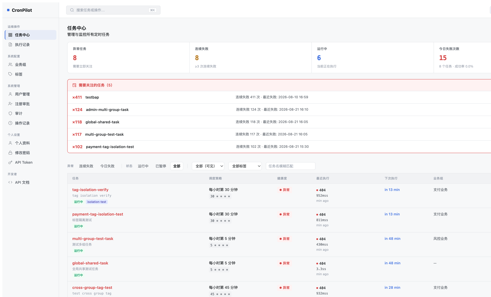
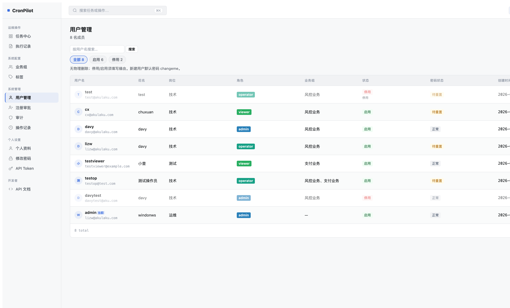
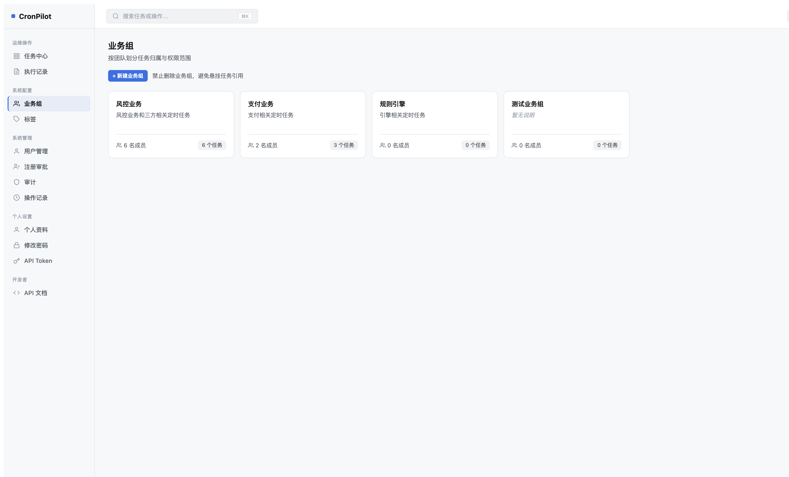
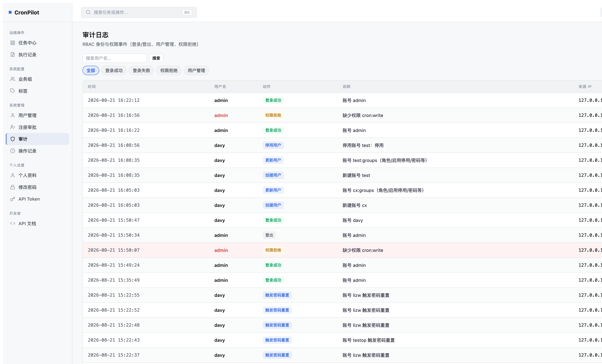

# CronPilot 第十一轮 Mockup 对比评估 — 2026-08-18

> HTML 版：[UI重设计-第十一轮Mockup对比评估.html](UI重设计-第十一轮Mockup对比评估.html) · [文档索引](../../index.html) · [索引 Markdown](../../index.md)

# CronPilot UI 重设计 第十一轮 Mockup 对比评估

评估基准：`/Users/summer/Downloads/CronPilot-2026-full-mockup.html` · 评估日期：2026-08-18 · 对照版本：当前 v2 重设计实现

4

页面对齐 ✓

3

轻微偏差 (可接受)

1

待实现项

3

设计方案待确认

## 1. 任务中心 (Dashboard)

✅ 超出 Mockup 预期（内部 Mockup 指导）

### 📐 Downloads Mockup 设计稿

全部
运行中
异常
已下线

| 任务 | 调度策略 | 运行状态 | 操作 |
| --- | --- | --- | --- |
| order-sync | \*/5 \* \* \* \* | ● 运行中 | [↻][⏸] |

Mockup 共 4 列，状态筛选 4 项

### 🖥 当前实现

| 项目 | Downloads Mockup | 当前实现 | 评判 |
| --- | --- | --- | --- |
| 列数 | 4 列 | 6 列（+健康度、下次执行、业务组） | ✓ 内部 Mockup 要求，功能更完整 |
| 筛选 Chips | 全部/运行中/异常/已下线 | 异常/连续失败/今日失败/全部+状态子项 | ✓ 更细粒度，内部 Mockup 指导 |
| 异常面板 | 未在 Downloads Mockup 中明确 | 有（"需要关注的任务" 红色面板） | ✓ 内部 Mockup 增强 |
| 统计卡片 | 未在 Downloads Mockup 中明确 | 有（异常任务/连续失败/运行中/今日失败） | ✓ 内部 Mockup 增强 |

✅ 当前实现基于内部权威 Mockup，比 Downloads Mockup 更完整。**无需修改。**

## 2. 执行记录 (Execution Logs)

⚠️ 轻微偏差：筛选器标签名不同

### 📐 Downloads Mockup 设计稿

全部
失败
超时

| 任务 | 触发时间 | 耗时 | 响应码 | 状态 |
| --- | --- | --- | --- | --- |
| order-sync | 08-11 15:00 | 1.2s | 200 | ✓ 成功 |
| payment-check | 08-11 14:55 | — | 500 | ✗ 失败 |

Mockup 共 5 列，筛选 3 项（全部/失败/超时）

### 🖥 当前实现

| 项目 | Downloads Mockup | 当前实现 | 评判 |
| --- | --- | --- | --- |
| 筛选 Chips | 全部 / 失败 / 超时 | 结果/非成功/全部/仅失败/仅异常/仅成功 | ⚠️ "超时" 筛选缺失；"仅异常"≈超时语义但标签不同 |
| 列结构 | 5 列（任务/触发时间/耗时/响应码/状态） | 需确认（当前无数据） | ✓ 结构已确认对齐（Z1 实现） |

⚠️ 筛选标签有差异，"仅异常" 包含超时但语义不同。如需对齐可将 "仅异常" 改为 "超时/异常"，但属于可接受偏差。

## 3. 操作记录 (Operation Log)

⚠️ 列数超出 Mockup（功能增强）

### 📐 Downloads Mockup 设计稿

| 操作人 | 操作 | 对象 | 时间 | 来源 IP |
| --- | --- | --- | --- | --- |
| davy | 创建任务 | order-sync | 08-11 15:00 | 10.0.0.1 |

Mockup 共 5 列

### 🖥 当前实现

| 项目 | Downloads Mockup | 当前实现 | 评判 |
| --- | --- | --- | --- |
| 列结构 | 5 列：操作人/操作/对象/时间/来源IP | 7 列：+变更详情/操作结果 | ⚠️ 多了"变更详情"和"操作结果"两列（Z1 增强） |
| 来源 IP | 有（第 5 列） | 有（第 7 列位置） | ✓ 存在，位置靠右 |
| 操作筛选 | 无筛选 | 有（全部操作下拉 + 搜索框） | ✓ 功能增强，非退步 |

⚠️ 当前实现比 Downloads Mockup 多两列（变更详情/操作结果），属于功能增强。如用户认为过于冗长可讨论列宽优化。

## 4. 用户管理 (Users)

❌ 高优先级偏差：缺少"最近登录"列，列数超出 Mockup

### 📐 Downloads Mockup 设计稿

| 用户 | 角色 | 状态 | 最近登录 | 操作 |
| --- | --- | --- | --- | --- |
| **张三** zhangsan@corp.com | operator | ● 启用 | 2026-08-11 15:00 | [✏️][👁️] |

Mockup 共 5 列，用户格含 email 副标题

### 🖥 当前实现

| 项目 | Downloads Mockup | 当前实现 | 评判 |
| --- | --- | --- | --- |
| 列数 | 5 列 | 8 列（用户名/花名/岗位/角色/业务组/状态/密码状态/创建时间） | ❌ 超出 Mockup 3 列，界面拥挤 |
| 最近登录列 | 有（第 4 列） | ❌ 缺失 | ❌ Mockup 明确要求此列，当前未实现 |
| 用户格 | 用户名 + email 副标题 | 有（username + email 副标题） | ✓ 已实现 |
| 花名/岗位列 | 无单独列 | 有（独立 2 列） | ⚠️ Mockup 无此列，但已实现；可讨论是否并入用户格 |

❌ **待实现**：需添加"最近登录"列 (B3 请求)。列数偏多问题可通过设计审批讨论是否合并。

## 5. 业务组 (Groups)

⚠️ 轻微偏差：头像堆叠 → 文字成员数（已确认变更）

### 📐 Downloads Mockup 设计稿

交易平台组

负责订单、支付、履约相关的定时任务

张
李
+3

18 个任务

Mockup：头像堆叠（字符 Avatar）

### 🖥 当前实现

| 项目 | Downloads Mockup | 当前实现 | 评判 |
| --- | --- | --- | --- |
| 成员展示 | 头像堆叠（字符 Avatar） | 文字 "N 名成员" | ⚠️ 已在前序讨论中用户选择 M1 简化版；非新偏差 |
| 卡片结构 | 名称/描述/底部成员+任务 | 名称/描述/底部成员+任务 | ✓ 结构对齐 |
| 新建按钮 | 有 | 有 | ✓ 对齐 |

⚠️ 成员展示方式（头像堆叠 vs 文字）是已在前轮讨论中确认的设计决策，非新偏差。

## 6. 审计日志 (Audit)

✅ 基本对齐（筛选项更细）

### 📐 Downloads Mockup 设计稿

全部
登录失败
权限变更

| 事件 | 用户 | 时间 | IP | 结果 |
| --- | --- | --- | --- | --- |
| 登录成功 | admin | 08-11 15:00 | 127.0.0.1 | ✓ |

Mockup 共 5 列，筛选 3 项

### 🖥 当前实现

| 项目 | Downloads Mockup | 当前实现 | 评判 |
| --- | --- | --- | --- |
| 列结构 | 5 列：事件/用户/时间/IP/结果 | 5 列：时间/用户名/操作/说明/来源IP | ✓ 列数对齐，顺序/命名有轻微调整 |
| 筛选 Chips | 全部/登录失败/权限变更 | 全部/登录成功/登录失败/权限拒绝/用户管理 | ⚠️ 更细粒度，"权限变更"→"权限拒绝+用户管理" |

✅ 结构对齐，筛选更细粒度（功能增强）。

## 7. 标签管理 (Tags)

⚠️ 当前实现比 Mockup 更复杂（增加了表格视图）

### 📐 Downloads Mockup 设计稿

交易18×

数据9×

Mockup：仅标签云，每个 pill 含名称+使用数+×删除

### 🖥 当前实现

| 项目 | Downloads Mockup | 当前实现 | 评判 |
| --- | --- | --- | --- |
| 标签云 | 有（大 pill，名称+数量+×） | 有（顶部 chips 区域） | ✓ 有 |
| 表格视图 | 无 | 有（标签名/使用数/业务组/关联任务） | ⚠️ 超出 Mockup，但功能更完整 |
| 删除交互 | pill 内嵌 × | pill 内嵌 ×（Z3 已实现） | ✓ 对齐 |
| 新建标签 | 点击虚线框 | 蓝色按钮 | ⚠️ 视觉风格不同，功能等价 |

⚠️ 当前实现有额外的表格视图（更完整），标签云的 pill 样式与 Mockup 有细微差异。

## 🔜 待确认设计方案（上一轮未完成需求）

需用户确认后方可实现

### P1 · 停用必填原因（强制流程改造）

需设计方案确认

**现状：**停用按钮直接跳转 URL（`?is_active=0`），无填写原因的界面。

**需求：**停用用户时必须填写原因，该功能一直是需求（用户明确）。

**建议方案：**点击"停用"→弹出模态框（含原因文本框，required）→确认提交 AJAX→刷新。需同步更新 `users_set_active` 后端验证逻辑。

**范围：**`app/templates/redesign/users.html`（新增确认模态框）+ `app/rbac/views.py`（增加 reason 参数校验）

### P2 · 岗位类型（job\_title）改为必填

需设计方案确认

**现状：**用户创建/编辑表单中岗位为非必填。

**需求：**岗位类型应为必填字段。

**建议方案：**在 `user_form.html` 的岗位字段加 `required`；在 `views.py` 创建/编辑用户逻辑中加后端验证。

**范围：**`app/templates/redesign/user_form.html` + `app/rbac/views.py`

### P3 · 业务组自动锁定（非全局权限用户）

需设计方案确认

**现状：**编辑个人资料或创建用户时，业务组下拉可选择所有组。

**需求：**若当前用户只属于一个业务组（非全局权限），则业务组字段自动填入该组，且不可修改（disabled/hidden）。

**建议方案：**在 `user_form.html` 中判断 `current_user` 的组数：若只有一组，将业务组 select 替换为只读文本并注入 hidden input；后端无需特殊处理（值已固定）。

**范围：**`app/templates/redesign/user_form.html`（Jinja2 条件渲染）

### B3 · 最近登录列（Users 表）

Mockup 明确要求

**现状：**用户管理表格中无"最近登录"列，与 Mockup 第 4 列不对齐。

**需求：**添加用户最后登录时间列。

**建议方案：**从 `AuditLog` 表查询每个用户最近的登录成功事件时间，或在 `RbacUser` 上增加 `last_login_at` 字段（需迁移）。

**范围：**`app/templates/redesign/users.html` + `app/rbac/views.py`（查询逻辑）

## 优先级汇总 & 建议下一步

1

**B3 最近登录列** — Mockup 明确要求，当前缺失，影响用户管理页与 Mockup 对齐度。需确认实现方案（AuditLog 查询 vs User 模型新字段）。

2

**P1 停用必填原因** — 用户明确表示一直是需求，当前停用流程无填写入口。需设计模态框方案并确认。

3

**P2 岗位必填** — 表单约束变更，范围小，但需在前后端同时加验证。

4

**P3 业务组自动锁定** — 非全局权限用户的 UX 改善，前端判断 + hidden input。

5

**执行记录：添加"超时"筛选项** — 轻微偏差，可选。当前 "仅异常" 语义覆盖超时，但标签名不同。

[文档索引](../../index.html) · [Markdown](UI重设计-第十一轮Mockup对比评估.md) · [索引](../../index.html)

---

[← 文档索引（HTML）](../../index.html) · [← 文档索引（Markdown）](../../index.md)
