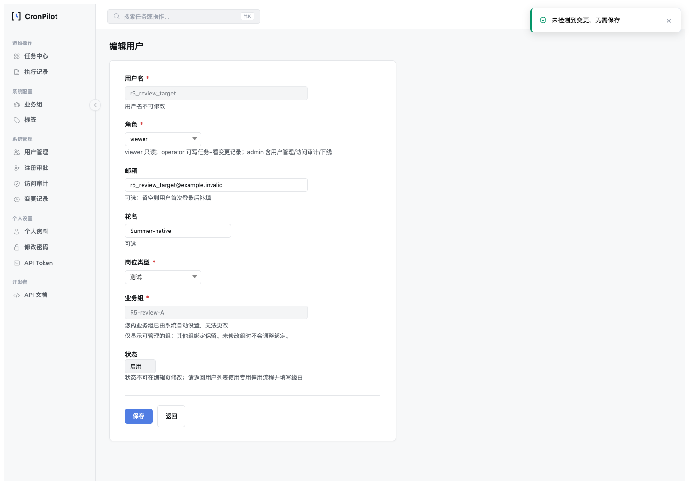

# RBAC 用户编辑范围外组误删修复复盘

> HTML 版：[2026-10-RBAC用户编辑范围外组误删.html](2026-10-RBAC用户编辑范围外组误删.html) · [文档索引](../index.html) · [索引 Markdown](../index.md)

# RBAC 用户编辑范围外组误删修复复盘

日期：2026-10-29 · rev.1 · 状态：已按确认设计实施并验证；尚未 commit。

| 版本 | 日期 | 变更 |
| --- | --- | --- |
| rev.1 | 2026-10-29 | 按用户明确确认的 R5 设计实施签名编辑范围、同范围意图比较与外组保护；记录双后端和真实浏览器证据。 |

## 1. Bug 定位

单组 A 管理员打开 A+B 用户，表单只提供 A，原始快照却是 A+B。未改组或只改花名时会被误判组变更；update\_user\_management 原全量替换循环可能删除 B。既有管理员 Scope 设计 §3.6/§7 已明确应保留范围外绑定。

## 2. 根因

意图层把“完整数据库集合”和“可编辑表单集合”当成同一语义比较；写入层把可见组提交当作全量替换指令。行为上的问题是沿用全局管理员表单假设实现受限管理员路径，未把已有外组保留契约转成独立验收场景。

## 3. 测试漏洞

原测试的单组管理员与目标都仅绑定同一组，多组目标测试则使用可管理全部目标组的管理员；缺少 actor A / target A+B 的交叉组合。仅检查成功与 Token 变化，没有在“只改花名”场景直接断言关系表零 DML。原签名篡改单测改最后一个 Base64 字符可能只改未使用补位，实际签名字节相同；现改签名首字符，确保真实改变签名字节。

## 4. 修复

- 编辑签名升为 v2：保留目标完整 group\_ids，加入签名 editor\_scope；全局模式仅记录 bypass，不装入全部业务组。旧 v1 页面拒绝提交，需显式刷新。无 DB 迁移和外部 API 字段变化。
- project\_user\_edit\_values 为 JS 与服务端提供同一可编辑投影。意图比较 A 对 A，不再产生假组变更。原生失败回显仍逐字保留原 token，只读邮箱来自同一原值。
- 路由在 no-op 前核对当前编辑范围；服务锁内再次从当前 actor 及关系行核对权限与编辑范围。签名只证明 GET 上下文，不替代授权。
- 资料-only 只执行实际字段写入和审计；不执行组 DML、不改角色/Token/auth\_version/缓存。无关的并发组和角色保持当前值；修改字段冲突仍拒绝。
- 真实授权变更保留原范围外组，授权校验只针对可管理请求集合；完整 role+group\_ids 三方比较仍保护并发，实际关系删除限定可管理集合。重复等价授权请求不再次 bump。
- 最后管理员降权保护仅在实际 role 差异时执行，避免只改资料时把陈旧未修改角色当降权请求。

## 5. 防护测试与验收

最新专项结果：联合 236/236（311.900 秒，前 8 项 R5 测试）；随后增加两个直接覆盖原生回显与资料冲突的用例，10/10 专项通过（7.375 秒）。86/86 路由、18/18 真 DOM preflight、8/8 live 浏览器、P1 六项真实浏览器回归、SQLite 黄金路径均通过。全量 discovery 1020 项，439.590 秒，OK（skipped=12）；其发现时载入了 8 项 R5 用例，另两项新增后已由 10 项专项单独覆盖。Ruff、UI 契约、颜色、路由完整性通过。文档同步/完整性/链接、OPT、pending 门禁通过；复盘门禁 exit=0，仍有 41 条历史 Release 引用警告，未扩散修改。12 项跳过中 11 项因沙箱无法探测本地服务，1 项为既有孤儿 ID 演示分支；并非 1020 项全都实际执行。随后提供已有测试账号，在授权网络环境补跑 `tests.test_csrf_integration tests.test_cron_ops_integration`，11/11 通过（2.730 秒）；余下仅既有孤儿 ID 演示分支未执行。

```
.venv-py311/bin/python -m unittest tests.test_user_edit_scope_projection -v
.venv-py311/bin/python -m unittest tests.test_user_edit_change_set tests.test_user_edit_scope_projection tests.test_user_edit_mysql_guard tests.test_rbac_global_scope_assignment tests.test_rbac_phase tests.test_user_reactivation tests.test_ajax_form_guard tests.test_redesign_sidebar -q
.venv-py311/bin/python scripts/verify_user_edit_group_preflight.py --executable-path '/Applications/Google Chrome.app/Contents/MacOS/Google Chrome'
.venv-py311/bin/python scripts/smoke_routes.py --check
bash scripts/verify_golden_path.sh
bash scripts/cronpilot.sh test
```

MySQL 8 使用独立新库 `cronpilot_user_edit_verify_ae9c7fa82b6c`，验收用户仅有 SELECT/INSERT/UPDATE/DELETE/CREATE/INDEX，无 DROP 权限（R5 的关系差异用例增加了专用库内 DELETE 权限），保留专用库。脚本 `scripts/verify_user_edit_transaction_mysql.py --database-url <fresh-dedicated-url>` 已扩充 R5 验收；schema 必须每次新建，不能复用已占用库。

```
MYSQL_USER_EDIT_U2: OK isolated_schema=1 lock_wait_observed=1 conflict=1 lock_release_ms=4.2 audit_rows=1
MYSQL_USER_EDIT_R5: OK profile_only=1 outside_preserved=1 replay=1 auth_conflict=1 concurrent_profile=1
```

Docker 控制接口无响应，但 MySQL 端口 33079 可用，故通过该实例的新专用库完成。未重启 Docker 或干扰其他容器。真实浏览器成功按 HTTP/导航与数据库差异判断，避免 Ajax 快速跳转后读取响应体的竞态。黄金路径接管 5001 端口，曾打断并行浏览器；已串行重跑并重新保留开发服务。

## 6. 同类排查

核对所有 build\_user\_edit\_snapshot 调用（GET/helper、服务单测、Scope 测试、MySQL 工具）；均由数据库 actor 解析编辑范围或使用请求同源上下文。验签 v2 严格拒绝缺失/非法 editor\_scope、旧版本及 actor/target 失配。创建/注册是完整赋权入口，继续原子集校验，不套用“保留旧外组”逻辑。update\_user/set\_user\_groups 等内部专用调用并非本编辑表单入口，未扩大修改范围。

## 7. 预防方案

- 新增 `tests/test_user_edit_scope_projection.py` 纳入现有 unittest discovery：actor A / target A+B，以及 actor A/C / target A+B 成为固定交叉矩阵；直接监测 SQL，断言资料-only 无关系 DML，并 mock Token/cache 副作用。
- 同文件固定真正授权并发冲突、资料并发保留、原生 T0 回显与同投影、当前 actor Scope 变化、非法新增组、旧/缺失/坏签名 schema 负例；用实际持久化状态与审计键集合独立判定。
- MySQL 验收脚本新增 \_verify\_partial\_scope，通过真实事务验证范围外保护和重复请求。执行前新建专用库；可复现命令见上节。
- 本地验收时先完成占用端口的黄金路径，再 restart，随后串行运行 UI 浏览器；此执行顺序固定在本复盘验收规程，避免服务生命周期导致假失败。

## 8. 本地复验

入口 `http://127.0.0.1:5001/rbac/login`，测试账号 `r5_review_single`，密码 `R5Review!2026`。仅为本地测试 fixture，不是产品默认密码。账号只管理 R5-review-A，目标 `r5_review_target`（id=49）绑定 R5-review-A/B。测试专用账号/组保留，服务保持运行。最终重启后实际 POST 登录通过，登录页/复盘 HTML/MD 均为 200；完整目标组 [16,17]、可编辑组 [16]、原样保存业务 POST=0。补跑 HTTP 用例创建的两项专用任务已通过正式下线入口下线，避免后续定时触发；见[最终就绪断言](../qa/evidence/rbac-r5-2026-10-29/final-ready.json)。

1. 登录后打开 `http://127.0.0.1:5001/rbac/users/edit?id=49`：只能看到锁定 A，提示外部组保留。
2. 原样保存：留页提示无变更，浏览器不发业务 POST。
3. 仅改花名再保存：跳转用户列表；目标完整组仍为 A+B，角色/邮箱/认证版本/Token 不因本次保存变化，审计仅 nickname。
4. 打开 `/rbac/users/edit?id=50`（外部组目标）：拒绝进入编辑并回列表。operator 访问用户管理返回 403。

[8 项 live 结果](../qa/evidence/rbac-r5-2026-10-29/results.json) · [18 项 preflight](../qa/evidence/rbac-r5-2026-10-29/preflight.json) · [验收输出摘要](../qa/evidence/rbac-r5-2026-10-29/validation.txt)



[已确认设计](../design/R5用户编辑字段意图与范围外组保留设计-2026-10-29.html) · [文档索引](../index.html) · [Markdown 版](2026-10-RBAC用户编辑范围外组误删.md)

---

[← 文档索引（HTML）](../index.html) · [← 文档索引（Markdown）](../index.md)
