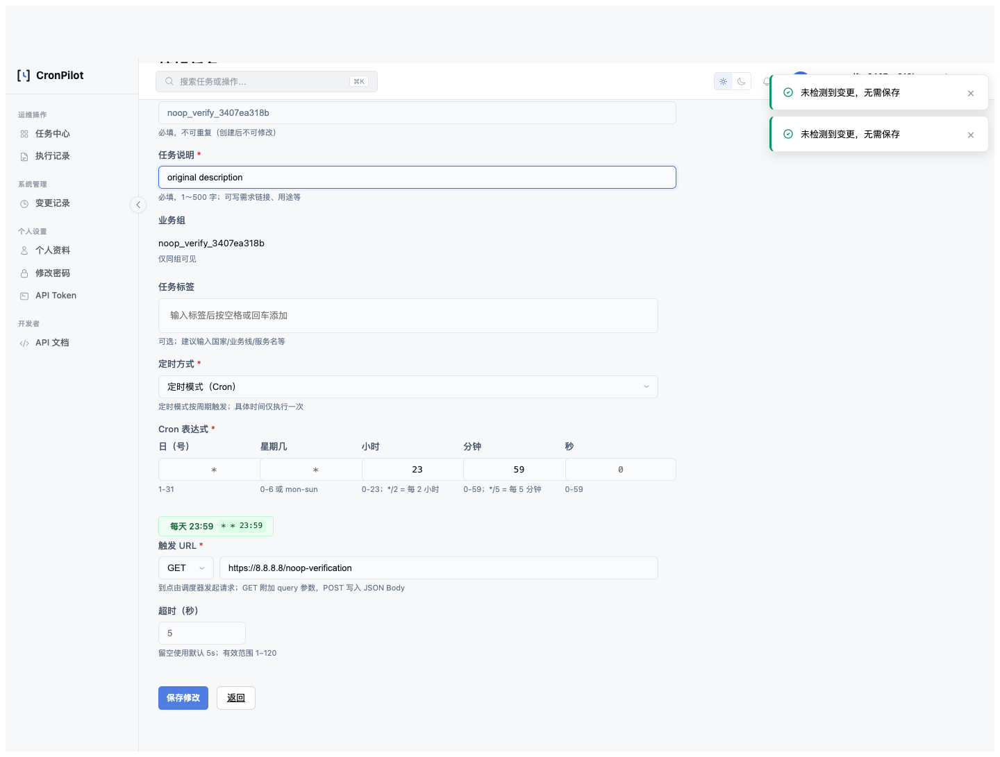

# 任务编辑无变更保存副作用修复复盘

> HTML 版：[2026-10-任务编辑无变更保存副作用.html](2026-10-任务编辑无变更保存副作用.html) · [文档索引](../index.html) · [索引 Markdown](../index.md)

# 任务编辑无变更保存副作用修复复盘

日期：2026-10-29 · 范围：问题① / 无变化编辑 · 状态：实现与验证完成，最终验收汇总见源设计第 11 节

## 1. Bug 定位

Web /cron\_edit、API 同名 upsert 和直接 update\_cron 调用，在输入与已有配置相同时，仍修改元数据、删除重建关系、调用调度器并记录成功配置日志。单组单标签暂停样例复现 6 条 DML、2 次提交、注册和暂停各一次。

## 2. 根因

服务以“收到保存请求”作为副作用触发条件，没有在赋值与关联同步前计算有效差异；纯解析与动态 DNS/过期检查混在一个校验器里，无法安全识别无需再次保存的旧配置。前端公共提交器只有 loading 与请求发送，任务页未接入现有预检事件。

行为层根因是验证只关注“最终字段是否正确”，未把“相同输入没有写入和外部副作用”列为可执行契约，因此即使任务最终字段一样，关系重写和调度重注册也未被发现。

## 3. 原测试漏洞

既有两个暂停编辑用例证明状态保持/恢复，不观测 SQL、commit 次数或 job 调用。原生回退也未在关闭 JS 的浏览器中验收，表单缺少原生 CSRF hidden 字段被 Ajax 的自动注入掩盖。

## 4. 修复

- 新增 cron\_edit\_noop.py，只读检查完整当前组/标签关联及全部配置字段；不赋值、不创建标签、不提交，异常结构拒绝自动修复。
- cron\_validator 分离 normalize\_cron\_form 与完整动态校验；只有已证明相同的请求跳过无必要 DNS/时效验证，新增和真实变更仍完整校验。
- 共享服务返回显式 outcome，旧模型/二元组返回包装器继续兼容；Web no\_change 留页，原生 POST 使用 PRG。
- 任务页面预检覆盖按钮与回车；待提交标签先加入实际提交模型，再判是否相同。补齐原生 CSRF；不增加凭据快照或浏览器持久存储。

## 5. 防护测试与实际验证

新增 tests/test\_cron\_edit\_noop.py，监听真实 SQL 并断言零 DML、commit、日志和 scheduler；覆盖逐字段真实变化、恢复命令、标签集合、API 省略语义、过期但未变配置、异常关系、旧式 group-only 调用，以及比较不 flush 调用方待写对象。

专项目标命令：`.venv-py311/bin/python -m unittest tests.test_cron_edit_noop tests.test_cron_edit_status -q`。MySQL 真实验证命令：`.venv-py311/bin/python scripts/verify_cron_edit_noop_mysql.py --port 33089`；3 个入口各为零 DML/commit/scheduler 写。随机库只在本次 CREATE 成功后删除，拒绝覆盖已有库。

浏览器命令：`.venv-py311/bin/python scripts/verify_cron_edit_noop_browser.py --output doc/qa/evidence/task-edit-noop-2026-10-29`；最终矩阵与清理结果见[JSON 证据](../qa/evidence/task-edit-noop-2026-10-29/result.json)。截图见下方。其他验收与全量测试的最终命令和结果统一记录在源设计，不复制未完成结果。

## 6. 同类排查与边界

Web、API 和直接服务三种入口共用防线，避免只修页面。新增任务继续走原完整写入；真实变化仍沿用原事务/调度/日志流程，因此并发覆盖、业务日志双事务、调度恢复和暂停窗口四项仍待独立设计，不宣称 EDIT-02/04/05/07 等全部合规。

浏览器角色预期曾把普通业务管理员误判为无 cron:write；核对 policy.py 后修正为普通管理员可写、Viewer 和种子 admin 拒绝。没有改变权限实现。验证脚本补齐测试账号资料，并在 finally 删除仅属于本次 fixture 的 job、任务、账号和关系，避免断言失败遗留调度条目。

## 7. 可执行预防方案

- 将 tests/test\_cron\_edit\_noop.py 纳入现有 unittest discover 自动范围；运行上列专项命令可独立复现，新增字段必须同时更新逐字段真变更反例，防止误吞。
- 使用 scripts/verify\_cron\_edit\_noop\_browser.py 固定“真实网络请求数 + DB 状态 + 禁用 JS + 待提交标签 + 角色”矩阵；不能以 toast 或 HTTP 200 替代有效副作用证据。
- 使用 scripts/verify\_cron\_edit\_noop\_mysql.py 对同一服务观测真实后端 DML，按需复验，不为此次优化扩张新的常驻基础设施。

## 页面证据

[文档索引](../index.html) · [Markdown](2026-10-任务编辑无变更保存副作用.md) · [源设计与最终验收](../design/任务编辑无变更保存零副作用独立设计-2026-10.html)

---

[← 文档索引（HTML）](../index.html) · [← 文档索引（Markdown）](../index.md)
