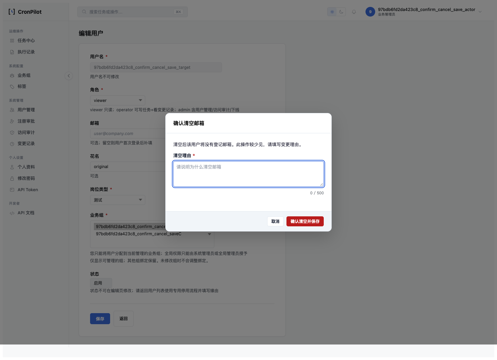
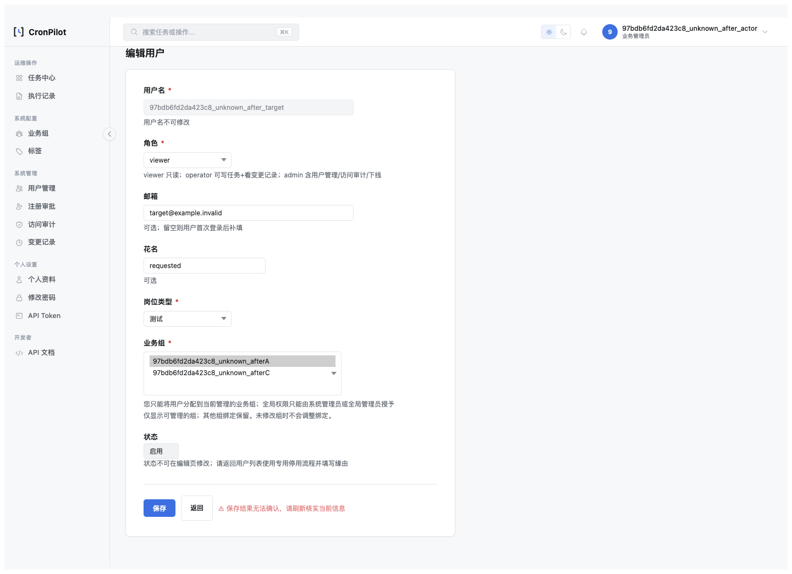
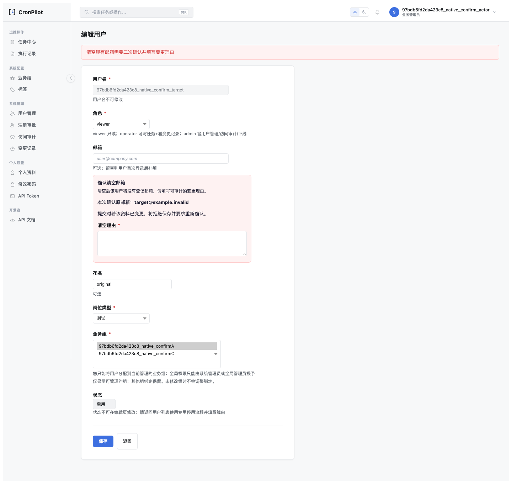

# RBAC 用户编辑七状态浏览器验收（2026-10-30）

> HTML 版：[RBAC用户编辑七状态浏览器验收-2026-10-30.html](RBAC用户编辑七状态浏览器验收-2026-10-30.html) · [文档索引](../index.html) · [索引 Markdown](../index.md)

# RBAC 用户编辑七状态浏览器验收（2026-10-30）

日期：2026-10-30 · 状态：**确认设计B1–B3实施完成；F2七状态证据与F3成本表述校准关闭。** 本批不修改生产业务、页面或锁协议，不宣称全仓事务治理完成。

设计：[七状态与锁成本校准设计 §10](../design/RBAC用户编辑七状态浏览器验收与锁成本文案校准设计-2026-10-29.html)；[七项复盘](../postmortem/2026-10-RBAC七状态浏览器验收与锁成本校准.html)。

## 1. 实际执行环境与范围

独立进程内Flask测试服务、随机回环端口、sqlite:///:memory:、StaticPool、逐请求run\_id哨兵；CSRF\_BYPASS\_IN\_TESTING=False。浏览器为本机Chrome 155.0.8059.80，使用Playwright、真实模板与公共JS。受限Biz Admin管理A/C、目标A+B，补非种子全局管理员和Operator/Viewer反向路径。账号密码随机生成，仅存在内存，不交付密码。未连接5001开发服务进行故障注入。

故障注入只绑定当前服务调用的具体Session：真实flush有DML后异常、commit调用前异常、真实commit完成后异常。所有注入只命中一次并恢复；recovery场景后续真实保存成功。prepared concurrent写入由第二个真实管理员会话通过现有入口完成，计数在其后重新开始；它不是同时争锁实验。

## 2. 七状态核心结论

- UPDATED：真实保存，一次提交、一次成功审计，资料-only不触碰关系/Token/认证版本/缓存。
- NO\_CHANGE：正常页面零POST；独立的浏览器同源构造POST验证服务端no\_change、零写。两种证据不互相替代。
- CONFIRM\_REQUIRED：正常模态取消零POST，确认后才保存；解除preflight的专门兜底例得到真实confirm\_required并由公共JS打开模态。原生POST保留T0及空邮箱输入，填理由后第二次提交成功。
- ALREADY\_APPLIED：另一管理员已提交相同目标；主浏览器基于旧T0提交，留页提示、零重复DML/成功审计/授权副作用。
- CONFLICT：O/C/R互异且带另一个意图字段，整次拒绝、不部分保存；Ajax留页，原生PRG读当前值。
- FAILED：自定义岗位空值/原生空岗位在服务端拒绝；真实flush后异常已产生SQL但业务与审计一起回滚。输入错误没有强求outcome事件。
- COMMIT\_UNKNOWN：提交前异常无持久化；提交完成后异常业务及同事务审计保留；页面都提示“保存结果无法确认”，不自动重试。授权子例版本只+1，缓存只失效一次。原生POST对应PRG通过。

UPDATED/部分FAILED沿用通用响应，没有人为补写data.outcome；results.json以outcome\_present区分缺键。每个恢复型Ajax结果先检查原按钮disabled/loading恢复，再刷新建立当前基线并点击no-op，证明可继续操作；unknown不直接盲目重试。

## 3. 逐场景结果（runner生成）

27项全部通过，无skip；30张脱敏截图。[完整JSON](evidence/rbac-outcomes-2026-10-29/results.json) · [命令与输出](evidence/rbac-outcomes-2026-10-29/validation.txt)。每项记录网络计数、实际响应、事件、业务差异、审计、认证版本、关系DML和缓存行为；凭据只比较布尔差异。

1. `updated`：updated；actual\_button；通过。
2. `no_change`：no\_change；actual\_button；通过。
3. `no_change_server`：no\_change；browser\_fetch；通过。
4. `confirm_cancel_save`：updated；actual\_button；通过。
5. `confirm_server`：confirm\_required；actual\_button；通过。
6. `already_applied`：already\_applied；actual\_button；通过。
7. `conflict`：conflict；actual\_button；通过。
8. `failed_field`：failed；actual\_button；通过。
9. `failed_flush`：failed；actual\_button；通过。
10. `unknown_before`：commit\_unknown；actual\_button；通过。
11. `unknown_after`：commit\_unknown；actual\_button；通过。
12. `unknown_after_auth`：commit\_unknown；actual\_button；通过。
13. `recovery`：updated；actual\_button；通过。
14. `global_updated`：updated；actual\_button；通过。
15. `global_no_change`：no\_change；actual\_button；通过。
16. `scope_denied`：access\_denied；access\_control；通过。
17. `operator_denied`：access\_denied；access\_control；通过。
18. `viewer_denied`：access\_denied；access\_control；通过。
19. `native_no_change`：no\_change；native；通过。
20. `native_confirm`：updated；native；通过。
21. `native_updated`：updated；native；通过。
22. `native_already_applied`：already\_applied；native；通过。
23. `native_conflict`：conflict；native；通过。
24. `native_failed`：failed；native；通过。
25. `native_unknown_before`：commit\_unknown；native；通过。
26. `native_unknown_after`：commit\_unknown；native；通过。
27. `csrf_denied`：failed；browser\_fetch；通过。

## 4. 关键截图

以下均来自受限Biz Admin的实际页面，其他状态截图位于同一证据目录。

### 正常清空确认（取消前）



### 真实提交完成后，应用仍提示结果未知



### 原生POST保留输入和确认理由入口



## 5. 验收命令与自证

```
.venv-py311/bin/python scripts/verify_user_edit_outcomes_browser.py --output-dir /private/tmp/rbac-outcomes-complete --executable-path '/Applications/Google Chrome.app/Contents/MacOS/Google Chrome'
RBAC_OUTCOMES: OK cases=27 isolated_memory=1 seven_states=1

.venv-py311/bin/python -m unittest tests.test_user_edit_browser_harness_guard tests.test_user_edit_change_set tests.test_user_edit_scope_projection tests.test_ajax_form_guard -q
Ran 64 tests in 55.617s — OK

.venv-py311/bin/python scripts/verify_user_edit_group_preflight.py --executable-path '/Applications/Google Chrome.app/Contents/MacOS/Google Chrome'
USER_EDIT_GROUP_PREFLIGHT: OK cases=18

.venv-py311/bin/ruff check app/ scripts/user_edit_browser_harness.py scripts/verify_user_edit_outcomes_browser.py tests/test_user_edit_browser_harness_guard.py
All checks passed!
```

64项含11项新工具守卫；非内存URI在初始化engine前拒绝；缺/重复/skip/失败case拒绝；未命中和多次命中注入拒绝；异常后方法恢复；真实commit后抛错仍持久化；工厂真实登录与CSRF；拒绝覆盖非空证据目录，避免旧绿色结果冒充新执行。

## 6. 用户复验

1. 无需登录即可打开本页，检查七状态与JSON一致，UNKNOWN的两组持久化结果不同。
2. 检查三张嵌入截图，确认真实模态、未知提示和原生回显均存在。
3. 重放时把上方命令的--output-dir替换为一个新的空目录；密码/账号由工具自动准备，不需要开发账号。
4. 预期输出cases=27、seven\_states=1，进程结束后检查新目录results.json为passed且含27个唯一case\_id；程序自动关闭自己拥有的临时服务，5001服务保持可用。

## 7. 限制与成本校准

SQLite用于页面和应用结果验证，不等于MySQL物理锁/间隙锁或网络断连测试；真实MySQL锁释放仍依[F1证据](../postmortem/2026-10-RBAC锁释放验收观察边界.html)。commit-after是可控应用层确认丢失模拟，不证明所有网络故障组合。F3已在[父设计rev.2.8 §7](../design/RBAC用户编辑差异写入与单事务收口独立设计-2026-10.html)注明管理员降权扩展锁集合，未改锁算法或给出未经测量的性能保证。

本批只改测试工具/测试/文档，按已确认设计§6不重启或改动开发业务服务；开发数据库表完整性已检查。文档最终同步与可达性门禁结果见复盘。

[Markdown 版](RBAC用户编辑七状态浏览器验收-2026-10-30.md) · [文档索引](../index.html)

---

[← 文档索引（HTML）](../index.html) · [← 文档索引（Markdown）](../index.md)
