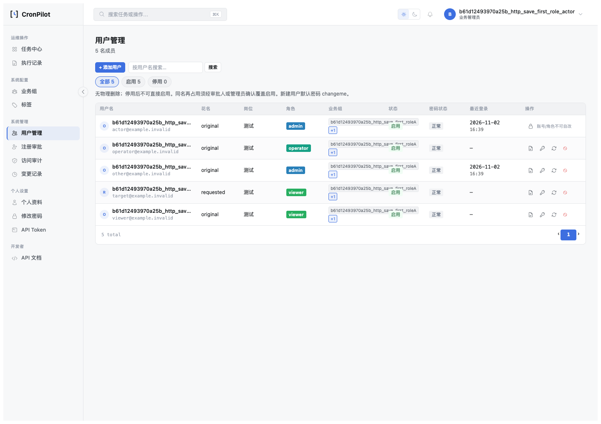
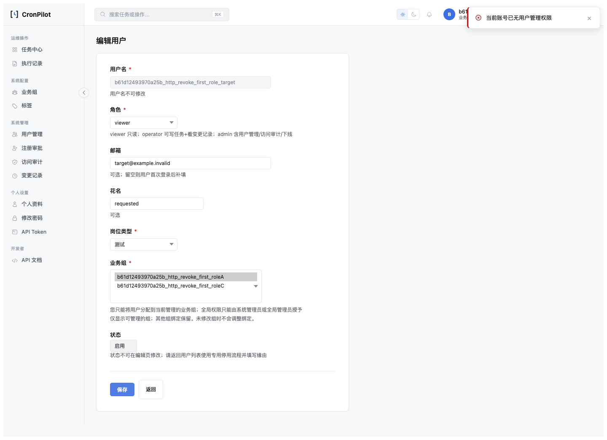

# SQLite 用户编辑原子保护验收（2026-11-02）

> HTML 版：[SQLite用户编辑原子保护验收-2026-11-02.html](SQLite用户编辑原子保护验收-2026-11-02.html) · [文档索引](../index.html) · [索引 Markdown](../index.md)

# SQLite 用户编辑原子保护验收（2026-11-02）

日期：2026-11-02 · **RBAC用户编辑原子保护已实现并通过专项验收；全仓发布条件未满足。** 任务保存同类问题仍开放，全量套件有6项在修复前基线同样失败。未提交或发布。

[批准设计与逐批记录](../design/SQLite用户编辑保存边界原子保护设计-2026-11-02.html) · [七项复盘](../postmortem/2026-11-SQLite用户编辑保存边界原子保护.html)。

## 1. 本批修改与专业评估

方案复核通过：SQLite行锁空缺需要在当前事实读取前建立物理保护；选择局部BEGIN IMMEDIATE，不修改MySQL、不扩大到全站engine配置。busy\_timeout仅在取得写者资格的极短窗口置0，立即恢复；取不到保护按现有FAILED返回，commit阶段异常继续COMMIT\_UNKNOWN。恢复失败淘汰连接，入口rollback失败不再逃出既有错误分类。

生产改动仅新增app/services/sqlite\_write\_boundary.py、修改services.py的update\_user\_management和一个import；与实施前副本对照，函数外其余内容不变，见[范围指纹](evidence/sqlite-user-boundary-2026-11-02/scope-integrity.json)。未改任务业务、页面、依赖pin、数据库结构或配置。顶层服务拒绝待提交ORM工作，原生SQL待写事务仍受禁止组合调用契约约束，不声称只查dirty集合就能发现原生写入。

## 2. 分步结果

1. **S0：**保存HEAD、未提交内容SHA256与原服务副本；两个journal模式分别校准无保护可写、有保护真忙、释放后可写，共6项控制实验。每个竞争者为spawn独立进程，无同线程互等。
2. **S1：**引入同Session/同模型bind保护；内存守卫14项通过，相关组合回归199项通过。包含连接归属、保护先于授权读、待写拒绝、入口/终态rollback失败、恢复失败、MySQL不发SQLite SQL等。
3. **S2：**DELETE/WAL服务场景36项、双HTTP实例真实浏览器交错8项、七状态/原生POST浏览器27项、真实MySQL9类正常路径及3类省略回滚控制均通过。隔离黄金路径和86路由冒烟通过。全部测试专用临时库已清理；常驻预览另用自己的专用库。
4. **S3：**补本文、复盘、设计状态、历史审查后续标注、Release Notes与双索引；准确保留全量失败、任务风险与运行版本限制，不把专项通过写成全仓可发布。

## 3. 并发语义与直接证据

- 撤权/停用/换组先提交：保护内重读后拒绝；同字段先提交：冲突；等价状态：不重复写；其他字段及外组保留。
- 保存先取得保护：竞争写入得到真正SQLITE\_BUSY；A先保存合法，释放后B可重新发起合法写入。不存在“凡撤权请求发起就必须让A失败”的错误断言。
- BEGIN忙、flush后失败、恢复失败无业务/成功审计残留；真实commit前后异常都未知，持久化事实分别核验；认证副作用按有效差异触发。

[36服务/8浏览器及任务诊断JSON](evidence/sqlite-user-boundary-2026-11-02/sqlite/results.json) · [真实MySQL证据](evidence/sqlite-user-boundary-2026-11-02/mysql/results.json) · [七状态JSON](evidence/sqlite-user-boundary-2026-11-02/outcomes/results.json) · [命令与原始输出摘要](evidence/sqlite-user-boundary-2026-11-02/validation.txt)。

### 实际页面：先保护保存，竞争操作随后进行



### 实际页面：撤权先完成，旧请求拒绝



## 4. 不能遗漏的未关闭事项

**任务保存：**旧诊断不再patch已删除scheduler属性，按当前save\_task\_edit接口用独立进程重新核验。在DELETE/WAL两模式均观察到actor已降为viewer而旧任务请求仍返回updated；仅在隔离进程替代URL安全校验以避免外部DNS，真实权限读取、比较、业务写入和提交执行。它不是本批用户编辑修复失败，但意味着发布前审查的整个SQLite条目不能整体关闭。按批准范围未修任务代码。

**全量：**bash scripts/cronpilot.sh test实际运行1132项，6失败、12跳过，其余1114通过。失败位于API scope旧成功断言3项、任务中心旧按钮/挂载点断言2项、启停CSRF旧成功断言1项。在独立最小源码副本仅还原实施前services.py后，相关17项仍有相同6项失败，见[基线对照](evidence/sqlite-user-boundary-2026-11-02/baseline-comparison.json)；不能把本次全量说成通过，也未扩展修复这些范围外问题。

仅本机Python 3.11.4执行；3.8语法解析通过，但3.8–3.10运行时未安装，未声称其实际运行验收。SQLite/MySQL结果不等于所有部署、跨库外部副作用或全仓写协议完成。

## 5. 可执行命令

```
.venv-py311/bin/python -m unittest tests.test_user_edit_sqlite_boundary -q
+.venv-py311/bin/python scripts/verify_user_edit_sqlite_boundary.py --output-dir /private/tmp/boundary-new-empty --executable-path '/Applications/Google Chrome.app/Contents/MacOS/Google Chrome'
+.venv-py311/bin/python scripts/verify_user_edit_outcomes_browser.py --output-dir /private/tmp/outcomes-new-empty --executable-path '/Applications/Google Chrome.app/Contents/MacOS/Google Chrome'
+.venv-py311/bin/ruff check app/ scripts/verify_user_edit_sqlite_boundary.py scripts/user_edit_sqlite_fixture.py scripts/user_edit_sqlite_http.py scripts/user_edit_sqlite_task_probe.py scripts/preview_user_edit_sqlite_boundary.py tests/test_user_edit_sqlite_boundary.py
```

所有输出目录须新建且为空。文件集成CLI只在自己创建的TemporaryDirectory中使用数据库，拒绝任意DB URL，路径及run\_id验证后执行；普通单元仍是内存库。用户本次“评估并实施”包含已展示设计§7.2的窄例外。未将此例外推广至其他测试。

## 6. 预览与人工复验

预览：<http://127.0.0.1:5091/rbac/login>，专用临时WAL库，已用新进程加载修复代码。登录账号/密码及目标URL仅保存在本机`/private/tmp/cronpilot-boundary-preview-credentials.json`（0600），不进入仓库或HTTP证据。此预览不是原5001环境，原开发库未被重建。

1. 打开登录页，预期200；从上述本机文件取得测试账号密码，实际POST登录。
2. 打开文件中的editor\_url，只改花名后保存，预期回用户列表；重新打开时新值可见。
3. 打开`/rbac/users/edit?id=<outside_id>`，预期不出现编辑表单，组外不可管理。
4. 需要复现真实竞争时运行上方CLI，预期`modes=2 controls=6 business=36 http=8`；JSON同时明确任务问题仍开放，不将其误读为任务已修复。

[Agent预览自证](evidence/sqlite-user-boundary-2026-11-02/preview/result.json)：GET登录200、真实POST登录、受限保存与组外拒绝通过。服务保持运行供复验。

## 7. 验证环境处置

黄金路径在专用代码副本、独立配置/数据库、5097端口运行并通过，未覆盖工作区conf.ini。首次直接运行既有冒烟脚本时，其应用工厂沿用了全局JobStore并报既有损坏错误，未产生路由汇总，不计通过；随后在隔离配置并关闭调度执行的源码副本中重跑86/86。预览首次接入docs蓝图时缺少其BASEDIR配置，文档返回500；已补配置、增加启动前真实文档路由预检并只重启本轮5091实例，重新验证四份HTML/Markdown均200。一次过大的临时源码复制含历史截图导致空间不足，已仅清理本轮副本并改为最小源码清单，未删除工作区文件。所有原始失败均未冒充产品通过。

## 8. 文档门禁

本轮实际检查：check\_doc\_completeness通过（392 HTML已登记）；check\_doc\_links通过（3039引用、0 broken）；tests.test\_check\_doc\_completeness 4项通过；check\_pending\_sync、check\_opt\_consistency、git diff --check、Ruff均通过；HTML/Markdown全局同步检查通过。check\_postmortem\_completeness退出0，保留41条既有历史引用警告，本次复盘已引用。QA与复盘HTML/Markdown在5091均HTTP 200。本报告保持“专项通过、全仓未全绿”的边界。

[Markdown 版](SQLite用户编辑原子保护验收-2026-11-02.md) · [文档索引](../index.html)

---

[← 文档索引（HTML）](../index.html) · [← 文档索引（Markdown）](../index.md)
